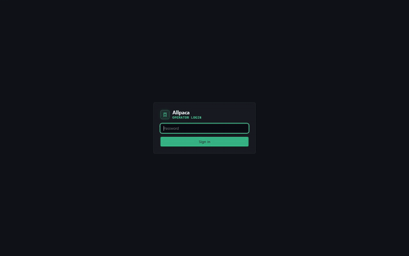

> **Note:** This project was completely vibe-coded to give myself a better understanding of how inference works hands-on, because that's how my idiot brain works. Enjoy!

# allpaca

*allpackin' these bits in here, also just another inference engine.*

Allpaca is an LLM inference engine written in Rust, with its own HIP (AMD) and CUDA (NVIDIA) kernels. It treats a pile of mismatched consumer hardware as one machine: two different GPUs in one box, an old MI50 server, an NVIDIA card in another room, a Strix Halo APU with 128 GB of unified memory, host RAM and NVMe. Then it tries to get a model that fits none of them alone to run fast across all of them. It serves an OpenAI-compatible (and Anthropic-compatible) HTTP API and has a built-in operator WebUI.

**License:** [MIT](LICENSE)



*Qwen3-Coder-Next (512-expert MoE, UD-Q5_K_XL, 55 GiB) running alone on a Strix Halo at ~31 tok/s in the chat. The video shows the dashboard's live telemetry, a streaming reply, and the expert heatmap filling in as the prompt routes tokens. [Full-quality MP4](docs/media/allpaca-demo.mp4).*

---

## Five things allpaca does really, really well

1. **Pooling hardware that was never meant to work together, with exact output.** One model can be split by layers or by experts across local GPUs and remote RPC workers: HIP and CUDA, RDNA4, RDNA3.5, gfx906 and Ampere. A remote worker must give the same bits as the local GPU, and it's checked: the `dense_digest` / `kquant_digest` tests, a deterministic `exp`, a build id in every worker's HELLO, and text-hash A/Bs. On xeres + sunny, Qwen3-Coder-Next with its experts spread across both machines runs at ~24 tok/s (measured), where neither machine alone can hold it.
2. **Speculative decoding that never changes the answer.** MTP heads, DFlash2 block-diffusion drafters, draft models, n-gram lookup and tree verification, with the draft depth tuned from measured cost. Speculative output must equal plain decode byte for byte within a build, and the benches check it. Qwen3.8-27B: 27.6 tok/s with DFlash2 vs 17.9 tok/s without (measured on an RX 9070 + RX 9060 XT, same text).
3. **Mixture-of-experts as a first-class citizen.** Fused MoE kernels for K-quants, Q8_0, MXFP4, ROCmFP4 and the paired-4:8 FP4 type. Expert-parallel RPC, per-layer expert pins to any device, a GPU expert cache with CPU misses, group-limited routing (Ling 2.0), DeepSeek-V4's hashed/MLA routing, and a WebUI heatmap where you can watch, name and switch off individual experts.
4. **AMD-first kernels that use the memory bandwidth.** Int8-dot GEMVs for every K-quant, Q8_0 and FP4 type, split-K attention and WMMA prefill on RDNA4, with occupancy taken from the card instead of a constant. On a Strix Halo the decode GEMVs reach 68-86% of the 256 GB/s peak and long-context attention 80% (measured, `bench_kernel_matrix`). On Windows, HIP runs on the RX 9070 and RX 9060 XT side by side.
5. **Being honest about speed.** `allpaca-bench ab` starts a fresh server per config every round, alternates them, reports wall-clock decode, first-token time, effective GB/s against each card's published peak, and a hash of every reply, so a "speed-up" that changes the text shows up at once. The dashboard shows the same numbers live, per device and per RPC worker.

---

## Features to date

### Models and architectures

| Family | GGUF `general.architecture` |
|---|---|
| Llama 3.x and friends | `llama` |
| Qwen 2 / 2.5, Qwen 3, Qwen 3 MoE | `qwen2`, `qwen2moe`, `qwen3`, `qwen3moe` |
| Qwen 3.5 / 3.8 dense + MTP, Qwen 3.5 MoE (Ornith 1.5) | `qwen35`, `qwen35moe` |
| Qwen3-Coder-Next (hybrid Gated DeltaNet + MoE) | `qwen3next` |
| Qwen 3.8 Flash-Next (experimental hybrid) | `qwen4exp` |
| DeepSeek V2-style MLA, DeepSeek-V4 Flash | `deepseek2`, `deepseek4` |
| Gemma 1 / 2 / 3 / 4 (incl. Nemotron-3.5-Bolt) | `gemma`, `gemma2`, `gemma3`, `gemma4` |
| Nemotron-H hybrid Mamba-2 + attention + MoE | `nemotron_h_moe` |
| Ling 2.0 (group-limited expert routing) | `bailingmoe2` |

- **Vision:** Qwen3-VL through an `mmproj` GGUF (`multimodal.vision_path`), images in chat messages and the WebUI.
- **Other formats:** HuggingFace SafeTensors (F32/F16/BF16, sharded index, Hub `org/name` download), ONNX weight import, split `*-NNNNN-of-MMMMM.gguf` shards.

### Weight types

F32, F16, BF16, Q4_0/1, Q5_0/1, Q8_0/1, Q2_K-Q6_K, IQ4_NL, IQ4_XS, TQ1_0, TQ2_0, MXFP4, Q1_0/Q2_0, plus our own:

- **ROCmFP4** (types 100/101), with fused int8 GEMVs.
- **ROCmFPX Q8** (type 103), which converts losslessly to Q8_0.
- **MoESQ paired-4:8 FP4** (type 200).
- **GSQ / RCO requantised** Flash-Next files.

Tools to make them: `requant`, `quant_kld` and the GSQ calibration examples in `crates/allpaca-core/examples`. NVFP4 (type 40) is in progress.

### Engine

- **Placement in device-preference order:** GPU > GPU over RPC > RAM > RAM over RPC > NVMe. Layer split across local GPUs, `tensor_split`, and asymmetric (big card target, small card draft) or mobile/APU tiers.
- **Continuous batching:** fair multi-request scheduling, chunked prefill, batched decode. Concurrent output must equal solo output.
- **Speculative decoding:** MTP, DFlash2 / DSpark drafters, draft models, n-gram, tree / token-forest verify, throughput-aware depth (`<model>.allpaca.spec-depth.*.json` sidecars).
- **KV and prompt cache:** paged KV across VRAM, pinned DRAM and NVMe. Radix prompt cache with q8 / f32 codecs, background writes, checkpoints for hybrid (DeltaNet / SSM) state, optionally kept on an RPC worker.
- **MoE:** fused expert kernels, expert-parallel RPC, per-layer expert pins (`rpc.expert_homes`), a per-expert GPU cache with CPU misses, live expert masks, usage recording.
- **Structured output:** JSON, JSON Schema and Lark grammars via `llguidance`, plus tool-call parsing and guardrails with interactive approval.
- **Windows extras:** DirectStorage 1.3 file → D3D12 → HIP uploads, `hipMemGetInfo`-based VRAM telemetry, and WDDM spill detection.
- **Exactness policy:** anything that breaks byte-exact output lives behind an `[experimental]` option and is off by default. Every bench sample is tagged `exact`, `distribution-exact` or `lossy`.

### Backends

| Backend | Status |
|---|---|
| HIP / ROCm (Windows + Linux) | Main backend. Tested on RX 9070 (gfx1201), RX 9060 XT (gfx1200), Radeon 8060S / Strix Halo (gfx1151), MI50 (gfx906) |
| CUDA | RPC worker with K-quant GEMMs, fused MoE, attention; tested on RTX 3060, RTX 3070 Ti, K80 / K6000 (sm_35/37) |
| CPU | Always works; AVX2 kernels, NUMA first-touch expert pool |
| Vulkan (rust-gpu) | Scaffold for small models |

### Server and WebUI

- **API:** `POST /v1/chat/completions` (OpenAI, streaming), `POST /v1/responses`, `POST /v1/messages` (Anthropic-style), `GET /v1/models`, `POST /v1/systemone` (decision models), `GET /stats`, `GET /metrics`, OTLP push.
- **Model management:** `/v1/model/load`, `/v1/model/reload`, `/v1/model/available`, expert usage, logs (`/v1/logs`, `/v1/logs/stream`) and API keys.
- **WebUI** (at `/`, password-protected):
  - **Dashboard:** throughput, ITL / TTFT, VRAM split, per-device and per-worker stats, speculation, batched decode.
  - **Chat Playground:** streaming, images, system prompt, export.
  - **Models & VRAM:** model switching, layer placement map, context / KV sizing, and the **expert placement map and heatmap**.
  - **Logs & Traces**, **API** explorer with keys, **Settings**.
- **Per-model settings:** a `<model>.allpaca.json` beside the GGUF is applied at load (expert names / masks, speculation mode, context).

### Tooling

- `allpaca-bench`: `run`, `ab` (fresh-start A/B with text hashes and roofline) and `report`.
- `allpaca-rpc-server`: the worker, with `--build-id`, a weight cache (`--cache-dir`) and a prompt-cache store.
- `scripts/deploy-worker.sh`: copy sources to a worker, build, restart, and print the build id.
- `rpc_link` (example in `allpaca-rpc`): round-trip and bulk-rate probe for a worker link.
- `bench_kernel_matrix`: the same kernels and shapes on every HIP device, as a CSV for before/after diffs.

---

## Build

You need a recent stable Rust toolchain from `rustup` (1.88+; distro `rustc` 1.85 is too old). Put `$HOME/.cargo/bin` first on `PATH`.

### CPU only

```bash
cargo build --release -p allpaca-server
cargo test --workspace
```

### HIP / AMD GPUs

`--features hip` needs the HIP **compiler** SDK (`hipcc` and `hip_runtime.h`), not just the runtime. Without it the crate still compiles, but as a stub: look for `hip feature is stub-only` in the build output, and for GPU tests that "pass" in 0.00 s.

```bash
cargo build --release -p allpaca-server -p allpaca-rpc-server --features allpaca-server/hip,allpaca-rpc-server/hip
cargo test -p allpaca-hip --features hip
```

- **Offload targets:** taken from `rocminfo` when a GPU is visible, otherwise `gfx906, gfx900, gfx1100, gfx1151, gfx1200, gfx1201`. Override with `AMDGPU_TARGETS=gfx1201,gfx1200`.
- **Linux, ROCm 10.1** (e.g. Ubuntu 26.10 on a Strix Halo): install the dev package, or headers are missing and the build is stub-only:
  ```bash
  sudo apt install amdrocm-core-dev10.1-gfx1151   # or the -gfx1201 / -gfx1200 variant
  export LD_LIBRARY_PATH=/opt/rocm/lib
  ```
- **Linux, runtime-only `/opt/rocm` without root** (Debian 13): `scripts/fetch-rocm-hip-sdk.sh` unpacks a ROCm 6.2.4 `hipcc` + LLVM into `~/.cache/allpaca/rocm-sdk`, and `build.rs` finds it.
- **Windows** (ROCm / HIP SDK 7.1, RX 9070 + RX 9060 XT): run from an MSVC (`vcvars64`) environment. `build.rs` copies the SDK 7.1 `amdhip64_7.dll` beside the built binaries and tests, because the driver's copy in System32 crashes them, and it writes the device-library path for `hipcc`. Don't copy the DLLs by hand, and unset `HIP_DEVICE_LIB_PATH` / `LLVM_PATH` if they point at a TheRock tree.
- **Linux, dual GPUs:** peer copies are measured at boot and used only if they beat host staging. A kernel with `CONFIG_PCI_P2PDMA=y` lets the formal enable path work on gfx906.

### CUDA / NVIDIA GPUs

Needs the CUDA toolkit (`nvcc`); without it `--features cuda` compiles a stub. The arch comes from `ALLPACA_CUDA_ARCH`, else `nvidia-smi`, else a toolkit-aware fat default (sm_86 / sm_89 / sm_120 on CUDA 12+, with sm_35/sm_37 on CUDA ≤ 11.4).

```bash
cargo build --release -p allpaca-rpc-server --features cuda
cargo test -p allpaca-cuda --features cuda
# Kepler (K80, driver 470): stage CUDA 11.4 without root
./scripts/fetch-cuda-toolkit.sh && ALLPACA_CUDA_ARCH=sm_37 cargo test -p allpaca-cuda --features cuda
```

### Vulkan (scaffold)

```bash
cargo test -p allpaca-vulkan --features vulkan   # ALLPACA_SKIP_VULKAN_SHADERS=1 for a stub
```

### Docker (CPU)

```bash
docker build -t allpaca:cpu . && docker run --rm -p 8080:8080 allpaca:cpu
docker compose up --build
```

---

## Run

### Smoke test, no weights

```bash
cargo run -p allpaca-server -- --synthetic --cpu-only --port 8080 --ui-password secret
```

Open `http://127.0.0.1:8080` and sign in with the password. If you don't set one, the server prints `webui password: …` once to stderr. The same secret works as `Authorization: Bearer` for API clients.

```bash
curl http://127.0.0.1:8080/v1/chat/completions \
  -H "content-type: application/json" -H "authorization: Bearer secret" \
  -d '{"model":"synthetic","messages":[{"role":"user","content":"hello"}],"max_tokens":8}'
```

### A real model

```bash
# from the command line
target/release/allpaca-server --model models/Qwen3.8-27B-GGUF/Qwen3.8-27B-UD-Q5_K_XL.gguf --ui-password secret

# or from a config file (copy allpaca.example.toml)
target/release/allpaca-server --config allpaca.toml
```

A minimal `allpaca.toml`:

```toml
[http]
password = "change-me"
host = "127.0.0.1"
port = 8080

[model]
id = "qwen3-coder-next"
path = "models/Qwen.Coder/UD-Q5_K_XL/Qwen3-Coder-Next-UD-Q5_K_XL-00001-of-00003.gguf"

[engine]
gpu_backend = "hip"        # hip | cuda | vulkan | cpu (auto picks HIP, CUDA, Vulkan, CPU)
target_device = "auto"

[sampling]
temperature = 0.0

[speculative]
enabled = true             # MTP / DFlash2 / n-gram, picked from what the model offers
```

Also available: `--model org/name` downloads from the HuggingFace Hub (`HF_TOKEN` for gated repos), and `--draft-model` adds a separate draft GGUF. The other config sections (`[kv]`, `[weights]`, `[prompt_cache]`, `[structured_output]`, `[multimodal]`, `[rpc]`, `[telemetry]`, `[experimental]`) are documented in [`allpaca.example.toml`](allpaca.example.toml).

### Across several machines (RPC workers)

RPC pools memory so a model that fits no single machine can still run. It doesn't make a model that already fits one machine faster: each remote layer costs round trips. Every worker must run the same build (the coordinator warns when build ids differ). Off-loopback binds need `--insecure-bind` plus a token, and there's no TLS, so keep it on a trusted network.

```bash
# on each worker (HIP; every GPU in one process, or --device hip:N / cuda:N)
ALLPACA_RPC_TOKEN=... allpaca-rpc-server --device hip --insecure-bind -H 192.168.69.2 -p 50052

# on the coordinator
allpaca-server --config allpaca.toml --rpc 192.168.69.2:50052 --rpc-token "$ALLPACA_RPC_TOKEN"
```

- **Layer split:** happens on its own when the model doesn't fit locally; `[rpc] tensor_split = [a, b, c]` sets it by hand (local GPUs first, then workers).
- **MoE models:** experts are spread across workers; `rpc.expert_homes` pins a layer's experts to one device.
- **Deploying a worker:** `scripts/deploy-worker.sh` copies the tree, builds and restarts it, and prints the build id.
- **Two-NIC lab setup:** see [docs/rpc-remote-test.md](docs/rpc-remote-test.md).

### Benchmark

```bash
# fresh server per config per round, alternating, wall-clock decode + text hashes
allpaca-bench ab --config a.toml --config b.toml --rounds 6 --tokens 128 --out ab.jsonl
allpaca-bench report ab.jsonl
```

Some measured numbers (greedy, 128-200 tokens, built-in prompts):

| Model | Hardware | tok/s |
|---|---|---|
| Qwen3-Coder-Next UD-Q5_K_XL (55 GiB) | Strix Halo alone (Radeon 8060S, 100 GiB GTT) | 33.8-34.3 |
| Qwen3-Coder-Next UD-Q5_K_XL | RX 9070 + RX 9060 XT + 2x MI50 over RPC | ~24 (n-gram spec ~29) |
| Qwen3.8-27B UD-Q5_K_XL | RX 9070 + RX 9060 XT, no spec / DFlash2 | 17.9 / 27.6 |
| Qwen3.8-27B UD-Q5_K_XL | Strix Halo alone | 9.6 |
| Ornith-1.5 9B / 35B-A3B Q8_0 | RX 9070 + RX 9060 XT | 36.7 / 36.1 |

The numbers come from different builds and dates; see `docs/BENCHMARK.md` for the runs themselves.

---

## Crate layout

| Crate / path | Role |
|---|---|
| `allpaca-types` | Config, devices, metrics, errors |
| `allpaca-core` | Engine, scheduler, model forwards, KV / weight tiers, speculation, prompt cache, RPC runtime |
| `allpaca-gguf` | GGUF parser, tokenizer extraction, custom quant types |
| `allpaca-safetensors` / `allpaca-onnx` | SafeTensors and ONNX importers |
| `allpaca-cpu` | CPU kernels and dequant |
| `allpaca-hip` / `hip/` | HIP FFI and the C/HIP kernel sources |
| `allpaca-cuda` / `cuda/` | CUDA FFI and kernels |
| `allpaca-vulkan` / `allpaca-shaders` | Vulkan host and rust-gpu shaders |
| `allpaca-rpc` / `allpaca-rpc-server` | Wire protocol, worker backends, the worker binary |
| `allpaca-server` | HTTP API and the WebUI (`crates/allpaca-server/ui`) |
| `tools/bench` | `allpaca-bench` |

## Docs

- Glossary and scope: [`CONTEXT.md`](CONTEXT.md)
- Architecture decisions: [`docs/adr/`](docs/adr/)
- Design notes: [`docs/OPPORTUNITY_DESIGN.md`](docs/OPPORTUNITY_DESIGN.md), [`docs/SPECS.md`](docs/SPECS.md)
- Benchmarks: [`docs/BENCHMARK_SPEC.md`](docs/BENCHMARK_SPEC.md), [`docs/BENCHMARK.md`](docs/BENCHMARK.md)
- Recipes: [`docs/RECIPES.md`](docs/RECIPES.md)

---

## Sources and acknowledgements

Ideas and formats studied and re-implemented on our own kernel ABI. DirectStorage is the one exception: its redistributable runtime is restored from Microsoft's pinned NuGet package at build time.

| Source | What we took |
|---|---|
| [llama.cpp](https://github.com/ggerganov/llama.cpp) / [ggml](https://github.com/ggml-org/ggml) | GGUF layout, quant block formats, the numeric reference we test against |
| [FreeToken](https://arxiv.org/abs/2608.16157) | Edge MoE: host expert pool, GPU LRU slots, CPU/PCIe miss split, elastic VRAM |
| kimi-k3-in-c and related dense-offload work | Pin-prefix + ring for dense layer streaming |
| Speculative decoding literature (MTP, DFlash / DSpark, tree verify) | Draft providers and verification |
| [AMD ROCm / HIP](https://rocm.docs.amd.com/) | Runtime, multi-device and peer copies |
| [Microsoft DirectStorage](https://learn.microsoft.com/en-us/windows/win32/direct3d12/directstorage) | File → D3D12 → HIP uploads on Windows |
| [Hugging Face Tokenizers](https://github.com/huggingface/tokenizers), [Hub](https://huggingface.co/docs/hub) and [SafeTensors](https://huggingface.co/docs/safetensors) | Tokenizers, downloads, weights |
| [llguidance](https://github.com/guidance-ai/llguidance) | Constrained JSON Schema / Lark decoding |

## License

Copyright (c) 2026 Allpaca contributors. Released under the [MIT License](LICENSE).
